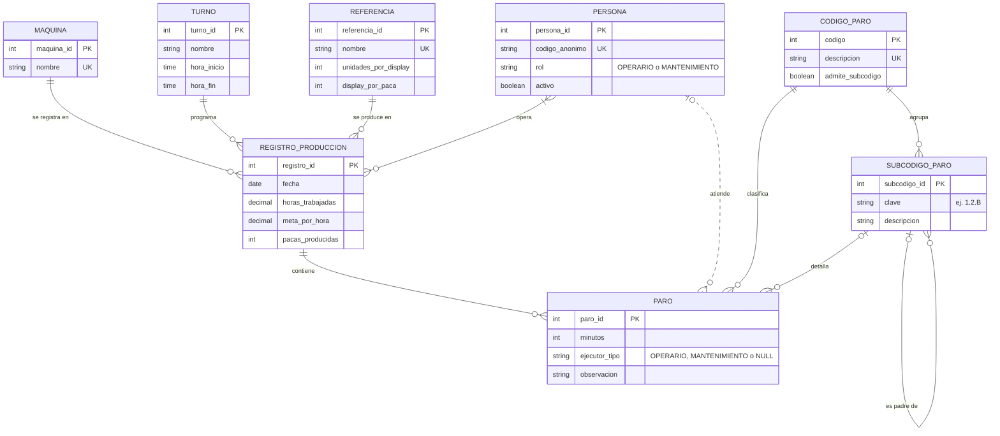

# Modelo conceptual (MER) – Registro de paros de producción

Notación: **pata de gallo (crow's foot)**, escrita en Mermaid (GitHub la renderiza directamente).
Para exportarla como imagen para el PDF: pegar el bloque en <https://mermaid.live> y descargar PNG/SVG.

## 1. Diagrama

> En el modelo conceptual no se dibujan llaves foráneas: las relaciones las representan. Las FK y la tabla intermedia `REGISTRO_PERSONA` aparecen al derivar el modelo lógico.

## 2. Entidades

| Entidad | Tipo | Descripción | Identificador |
|---|---|---|---|
| MAQUINA | Fuerte | Línea de envasado (Vinilos_1 a Vinilos_4) | maquina_id |
| TURNO | Fuerte | Franja horaria de trabajo (ej. 6am–2pm, 2pm–10pm) | turno_id |
| REFERENCIA | Fuerte | Producto envasado, con su presentación (unidades por display, display por paca) | referencia_id |
| PERSONA | Fuerte | Operaria/o o personal de mantenimiento (seudonimizado) | persona_id |
| CODIGO_PARO | Fuerte | Catálogo oficial de causas de paro [01]–[18] | codigo |
| SUBCODIGO_PARO | Dependiente de CODIGO_PARO | Detalle de la causa (1.2.B Ajuste de sensor, 3.2 Fallo en la red pública…) con jerarquía propia | subcodigo_id |
| REGISTRO_PRODUCCION | Fuerte | Una corrida de una referencia en una máquina, turno y fecha (una línea del formato "hora a hora") | registro_id (único natural: máquina + fecha + turno + referencia) |
| PARO | Débil (depende de REGISTRO_PRODUCCION) | Interrupción dentro de un registro, con su causa y duración | paro_id |

## 3. Atributos derivados (no se almacenan)

| Atributo del Excel | Cómo se obtiene |
|---|---|
| Día, Mes, Año | `EXTRACT` sobre `fecha` |
| Horas sin trabajar / Tiempo faltante | `SUM(paro.minutos)` por registro |
| Tipo de paro ("[19] No aplica") | Ausencia de filas en PARO |
| % Productividad | `1 − minutos_de_paro / minutos_disponibles` (⚠️ validar con el Excel) |
| % por código de paro | `minutos del código / minutos disponibles` |

## 4. Relaciones, cardinalidad y participación

| Relación | Entidades | Cardinalidad | Participación | Lectura |
|---|---|---|---|---|
| se registra en | MAQUINA – REGISTRO_PRODUCCION | 1 : N | MAQUINA parcial · REGISTRO total | Una máquina tiene 0..N registros; cada registro pertenece a exactamente 1 máquina |
| programa | TURNO – REGISTRO_PRODUCCION | 1 : N | TURNO parcial · REGISTRO total | Igual que la anterior |
| se produce en | REFERENCIA – REGISTRO_PRODUCCION | 1 : N | REFERENCIA parcial · REGISTRO total | Una referencia aparece en 0..N registros; cada registro tiene 1 referencia |
| opera | PERSONA – REGISTRO_PRODUCCION | N : M | PERSONA parcial · REGISTRO total | Cada registro lo atienden 1..N personas (varias líderes por hoja); una persona participa en 0..N registros |
| contiene | REGISTRO_PRODUCCION – PARO | 1 : N | REGISTRO parcial · PARO total | Un registro tiene 0..N paros; un paro no existe sin su registro (entidad débil) |
| clasifica | CODIGO_PARO – PARO | 1 : N | CODIGO parcial · PARO total | Todo paro tiene exactamente 1 código |
| detalla | SUBCODIGO_PARO – PARO | 1 : N | SUBCODIGO parcial · PARO parcial | Un paro tiene 0..1 subcódigo (el "(en blanco)" de los gráficos) |
| atiende | PERSONA – PARO | 1 : N | PERSONA parcial · PARO parcial | Un paro puede tener 0..1 persona que lo atendió; una persona atiende 0..N paros |
| agrupa | CODIGO_PARO – SUBCODIGO_PARO | 1 : N | CODIGO parcial · SUBCODIGO total | Cada subcódigo pertenece a exactamente 1 código |
| es padre de | SUBCODIGO_PARO – SUBCODIGO_PARO | 1 : N (recursiva) | Ambos parciales | Jerarquía 1.2 → 1.2.A, 1.2.B, 1.2.C |

## 5. Reglas de negocio

1. Cada registro corresponde a una sola máquina, turno, fecha y referencia; no puede haber dos registros iguales (llave natural).
2. Un registro debe tener al menos una persona responsable.
3. Un paro tiene siempre un código y una duración mayor que 0 minutos.
4. Un subcódigo solo puede asignarse a un paro si pertenece al código de ese paro (FK compuesta en el modelo lógico).
5. Un registro sin paros significa "no aplica" (se elimina el pseudocódigo [19]).
6. El campo `ejecutor_tipo` (operarios / mantenimiento) se usa en el análisis del código 05 y es opcional.
7. La suma de minutos de paro de un registro no debería superar los minutos disponibles (horas trabajadas × 60); se valida con trigger o en la carga.
8. `meta_por_hora` es histórica: no se actualiza retroactivamente cuando cambia la meta.
9. Las personas se identifican por un código anónimo; el nombre real no se expone en las consultas de análisis.

## 6. Paso al modelo lógico

| Elemento del MER | Resultado en el modelo relacional |
|---|---|
| Relación N:M `opera` | Tabla intermedia `REGISTRO_PERSONA(registro_id, persona_id)` con PK compuesta |
| Relaciones 1:N | FK en el lado N |
| Entidad débil PARO | FK `registro_id` NOT NULL con `ON DELETE CASCADE` |
| Participación total del lado N | FK `NOT NULL` |
| Participación parcial (0..1) | FK `NULL` (subcodigo_id, persona_id en PARO) |
| Relación recursiva | `padre_id` FK a la misma tabla |
| Regla 4 | FK compuesta (codigo, subcodigo_id) → SUBCODIGO_PARO |
