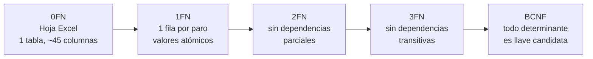

# Evidencia del proceso de normalización (0FN → 1FN → 2FN → 3FN → BCNF)

> **Nota sobre los datos de ejemplo.** Las filas de este documento son **ilustrativas**: se construyeron a partir del formato "hora a hora" y de la hoja "Base de Datos" del P-MTO-22. Antes de entregar, reemplázalas por 3 a 5 filas reales del `.xlsm` (conservando la estructura) para que la evidencia sea trazable al insumo original.



---

## 1. Punto de partida (0FN)

### 1.1 Estructura

**BASE_DE_DATOS**(Máquina, Turno, Día, Mes, Año, Fecha, Operaria/o, Referencia, Unidades producidas, Unidad por display, Display por paca, Horas trabajadas, Meta por hora, Pacas producidas, Horas sin trabajar, Tipo de paro, Observación paro, Tiempo faltante, % Productividad, Código1…Código18, Subcódigo1, Subcódigo3, Subcódigo5, Observación)

### 1.2 Muestra de datos (columnas relevantes)

| Máquina | Fecha | Turno | Operaria/o | Referencia | Horas | Meta/h | Pacas | Cód.1 | Cód.5 | Cód.16 | Subcód.1 | Subcód.5 |
|---|---|---|---|---|---|---|---|---|---|---|---|---|
| Vinilos_2 | 06/05/2025 | 6am-2pm (Turno 1) | Natalia P. | Rojo 125cc | 8 hrs | 52 | 179 pacas | 25 | 0 | 10 | 1.2.B Ajuste de sensor | |
| Vinilos_2 | 06/05/2025 | 2pm-10pm (Turno 2) | Lorena T. | Rosado 125cc | 8 hrs | 52 | 190 pacas | 0 | 15 | 10 | | 5.2 Sistema de dosificación de pintura |
| Vinilos_4 | 06/05/2025 | 6am-2pm (Turno 1) | Erica R. | Rojo 125cc | 8 hrs | 50 | 205 pacas | 0 | 0 | 12 | | |

(Los códigos 2–4, 6–15, 17 y 18 contienen 0 en estas filas y se omiten por espacio.)

### 1.3 Dependencias funcionales identificadas en el insumo

| ID | Dependencia | Fuente |
|---|---|---|
| DF1 | (máquina, fecha, turno, referencia) → operaria(s), horas trabajadas, meta/hora, pacas | Formato "hora a hora" |
| DF2 | código → descripción del código | Lista de códigos [01]–[18] |
| DF3 | subcódigo → descripción, código al que pertenece | Gráficos de códigos 01, 03 y 05 |
| DF4 | referencia → unidades por display, display por paca | Columnas del Excel |
| DF5 | turno → hora de inicio, hora de fin | Columna "Turno" |
| DF6 | fecha → día, mes, año | Columnas derivadas |
| DF7 | operaria/o → rol (operario o mantenimiento) | Gráfico del código 05 |
| DF8 | (todas las columnas de tiempo) → horas sin trabajar, tiempo faltante, % productividad | Cálculos del Excel |

### 1.4 Anomalías que presenta la estructura original

| Tipo | Ejemplo concreto | Consecuencia |
|---|---|---|
| **Inserción** | Para agregar un código 19 hay que añadir una columna a la hoja y a todos los libros de macros | No se puede crecer sin modificar la estructura |
| **Inserción** | No se puede registrar un subcódigo nuevo (p. ej. 3.4) sin que ocurra un paro que lo use | Los catálogos dependen de los eventos |
| **Actualización** | Si el código 10 se renombra, hay que corregirlo en miles de filas | Ya ocurrió: el código 10 tiene nombres distintos en el PDF y en el Excel |
| **Actualización** | Si "Rosado 125cc" se escribe "Rosado 125 cc" en una fila | Quedan dos referencias distintas y las sumas por referencia salen mal |
| **Borrado** | Borrar la fila de un registro para corregir un paro elimina también las pacas producidas | Se pierde información de producción |
| **Redundancia** | Un código con 0 minutos ocupa una celda en cada una de las 18 columnas | ~17 de cada 18 celdas de código son ceros |
| **Subcódigos ambiguos** | Con un solo "Subcódigo5", un registro con dos paros 05 distintos solo guarda uno | Pérdida de información |

---

## 2. Primera forma normal (1FN)

### 2.1 Regla

Cada celda contiene un valor atómico y no existen grupos repetitivos de columnas.

### 2.2 Qué se elimina y por qué

| Problema en 0FN | Transformación | Por qué |
|---|---|---|
| Grupo repetitivo `Código1…Código18` | Una **fila por paro** con columnas `codigo` y `minutos` | Quita las 18 columnas y permite códigos nuevos sin alterar la tabla |
| `Subcódigo1/3/5` | Una columna `subcodigo` por paro | El número solo indicaba a qué código pertenecía; ahora es un atributo del paro |
| "8 hrs", "47 pacas" | `horas_trabajadas` y `pacas` numéricos | Permite sumar, comparar y aplicar restricciones |
| "6am-2pm (Turno 1)" | Se separa en turno, hora de inicio y hora de fin | Mezclaba nombre y horario en una celda |
| "[19] No aplica" | Se mantiene temporalmente como código para tener llave | Se elimina en 3FN: un registro sin paros no necesita un código falso |

### 2.3 Resultado

**REGISTRO_PARO_1FN**(maquina, fecha, turno, referencia, operaria, unidades_display, display_paca, horas_trabajadas, meta_hora, pacas, codigo, desc_codigo, subcodigo, desc_subcodigo, minutos)

**Llave:** (maquina, fecha, turno, referencia, codigo, subcodigo) ⚠️ ver nota de la sección 3.3.

Con las 3 filas de muestra se obtienen 5 filas (una por paro):

| maquina | fecha | turno | referencia | operaria | horas | meta | pacas | codigo | desc_codigo | subcodigo | minutos |
|---|---|---|---|---|---|---|---|---|---|---|---|
| Vinilos_2 | 2025-05-06 | 1 | Rojo 125cc | Natalia P. | 8 | 52 | **179** | 01 | Falla del sistema electromecánico y/o de control | 1.2.B | 25 |
| Vinilos_2 | 2025-05-06 | 1 | Rojo 125cc | Natalia P. | 8 | 52 | **179** | 16 | Alimentación y aseo de la zona de trabajo y la máquina | | 10 |
| Vinilos_2 | 2025-05-06 | 2 | Rosado 125cc | Lorena T. | 8 | 52 | **190** | 05 | Ajuste operativo | 5.2 | 15 |
| Vinilos_2 | 2025-05-06 | 2 | Rosado 125cc | Lorena T. | 8 | 52 | **190** | 16 | Alimentación y aseo de la zona de trabajo y la máquina | | 10 |
| Vinilos_4 | 2025-05-06 | 1 | Rojo 125cc | Erica R. | 8 | 50 | **205** | 16 | Alimentación y aseo de la zona de trabajo y la máquina | | 12 |

### 2.4 Anomalías nuevas (que justifican la 2FN)

| Anomalía | Evidencia |
|---|---|
| **Suma inflada** | `SUM(pacas)` da 179+179+190+190+205 = **943**, pero la producción real es 179+190+205 = **574** |
| **Actualización parcial** | Corregir las pacas del primer registro en una sola de sus dos filas deja 179 y 185 en el mismo turno |
| **Borrado** | Borrar la única fila del registro de Vinilos_4 elimina su producción |
| **Inserción** | No se puede guardar un registro con cero paros sin inventar un código |

---

## 3. Segunda forma normal (2FN)

### 3.1 Regla

1FN + todo atributo no clave depende de **toda** la llave, no de una parte.

### 3.2 Dependencias parciales y su eliminación

| Dependencia parcial | Parte de la llave | Anomalía | Solución |
|---|---|---|---|
| (maquina, fecha, turno, referencia) → operaria, horas, meta, pacas | Los cuatro primeros campos | Datos de producción repetidos en cada paro (suma inflada) | `REGISTRO_PRODUCCION` |
| codigo → desc_codigo | codigo | Descripción repetida; renombrar exige tocar muchas filas | `CODIGO_PARO` |
| (codigo, subcodigo) → desc_subcodigo | codigo + subcodigo | Mismo caso | `SUBCODIGO_PARO` |
| referencia → unidades_display, display_paca | referencia | Presentación del producto repetida en cada paro | `REFERENCIA` |
| turno → hora_inicio, hora_fin | turno | Horario repetido y escrito de formas distintas | `TURNO` |
| fecha → día, mes, año | fecha | Atributos derivados (DF6) | Se eliminan, se calculan con `EXTRACT` |

> **Corrección respecto a la versión anterior del documento:** `referencia → presentación` y `turno → horario` son dependencias **parciales** (referencia y turno forman parte de la llave), por lo que se eliminan en 2FN y no en 3FN, como se indicó antes.

### 3.3 Resultado

| Relación | Atributos | Llave |
|---|---|---|
| REGISTRO_PRODUCCION | maquina, fecha, turno, referencia, operaria, horas_trabajadas, meta_por_hora, pacas | (maquina, fecha, turno, referencia) |
| PARO | maquina, fecha, turno, referencia, codigo, subcodigo, minutos, observacion | (registro, codigo, subcodigo, …) ⚠️ |
| CODIGO_PARO | codigo, descripcion | codigo |
| SUBCODIGO_PARO | codigo, subcodigo, descripcion | (codigo, subcodigo) |
| REFERENCIA | referencia, unidades_por_display, display_por_paca | referencia |
| TURNO | turno, hora_inicio, hora_fin | turno |

⚠️ **Nota sobre la llave de PARO:** un registro puede tener dos paros con el mismo código (dos paros "05 Ajuste operativo" en un turno). La llave natural no los distingue, y un subcódigo `NULL` no puede ser parte de una PK. Por eso se introduce la llave sustituta `paro_id`.

### 3.4 Datos tras 2FN

**REGISTRO_PRODUCCION** (3 filas, la producción ya no se repite)

| maquina | fecha | turno | referencia | operaria | horas | meta | pacas |
|---|---|---|---|---|---|---|---|
| Vinilos_2 | 2025-05-06 | 1 | Rojo 125cc | Natalia P. | 8 | 52 | 179 |
| Vinilos_2 | 2025-05-06 | 2 | Rosado 125cc | Lorena T. | 8 | 52 | 190 |
| Vinilos_4 | 2025-05-06 | 1 | Rojo 125cc | Erica R. | 8 | 50 | 205 |

`SUM(pacas)` = **574**, igual a la producción real.

**PARO** (5 filas) y **CODIGO_PARO** (descripción guardada una sola vez por código).

---

## 4. Tercera forma normal (3FN)

### 4.1 Regla

2FN + ningún atributo no clave depende de otro atributo no clave (sin dependencias transitivas).

### 4.2 Dependencias transitivas y su eliminación

| Dependencia transitiva | Anomalía | Solución |
|---|---|---|
| registro → operaria → rol, nombre | El mismo nombre aparece escrito de varias maneras ("Natalia P.", "Natalia Pérez"); el rol se repite | `PERSONA` |
| Una hoja tiene varias líderes (Natalia, Erica, Lorena en el formato en papel) | Un solo campo `operaria` no sirve | `REGISTRO_PERSONA` (N:M) |
| registro → (horas, paros) → horas sin trabajar, tiempo faltante, % productividad | Datos calculables que pueden quedar inconsistentes con los paros | Se eliminan; se calculan en **vistas** |
| paro → código → tipo de paro / "[19] No aplica" | El tipo se deduce del código; el 19 es un valor ficticio | Se eliminan; sin paros = no aplica |
| maquina como texto ("Maq #2", "Vinilos_2") | Alias distintos para la misma máquina | `MAQUINA` con nombre único |

### 4.3 Llaves sustitutas

Las llaves naturales compuestas (máquina + fecha + turno + referencia) y los nombres con alias se reemplazan por identificadores numéricos (`maquina_id`, `registro_id`, `paro_id`, etc.). La unicidad natural se conserva con un `UNIQUE`. Esto reduce el tamaño de las FK y aísla las tablas de los cambios de nombre.

### 4.4 Jerarquía de subcódigos

Los gráficos mezclan niveles (1.2 y 1.2.A). Se modela con la autorrelación `padre_id`. No es una dependencia transitiva: es una relación de jerarquía, y evita duplicar el código del padre en cada hijo.

### 4.5 Resultado 3FN

```
MAQUINA(maquina_id PK, nombre UNIQUE)
TURNO(turno_id PK, nombre, hora_inicio, hora_fin)
REFERENCIA(referencia_id PK, nombre UNIQUE, unidades_por_display, display_por_paca)
PERSONA(persona_id PK, codigo_anonimo UNIQUE, rol, activo)
CODIGO_PARO(codigo PK, descripcion UNIQUE, admite_subcodigo)
SUBCODIGO_PARO(subcodigo_id PK, codigo FK, clave, descripcion, padre_id FK)
REGISTRO_PRODUCCION(registro_id PK, maquina_id FK, turno_id FK, referencia_id FK,
                    fecha, horas_trabajadas, meta_por_hora, pacas_producidas)
REGISTRO_PERSONA(registro_id FK, persona_id FK, PK(registro_id, persona_id))
PARO(paro_id PK, registro_id FK, codigo FK, subcodigo_id FK NULL, minutos,
     ejecutor_tipo NULL, persona_id FK NULL, observacion)
```

---

## 5. Verificación de BCNF

Una relación está en BCNF si **todo determinante es llave candidata**.

| Relación | Dependencias funcionales | Llaves candidatas | ¿BCNF? |
|---|---|---|---|
| MAQUINA | maquina_id → nombre; nombre → maquina_id | maquina_id, nombre | Sí |
| TURNO | turno_id → nombre, hora_inicio, hora_fin | turno_id | Sí |
| REFERENCIA | referencia_id → todo; nombre → referencia_id | referencia_id, nombre | Sí |
| PERSONA | persona_id → todo; codigo_anonimo → persona_id | persona_id, codigo_anonimo | Sí |
| CODIGO_PARO | codigo → descripcion; descripcion → codigo | codigo, descripcion | Sí |
| SUBCODIGO_PARO | subcodigo_id → todo; (codigo, clave) → subcodigo_id | subcodigo_id, (codigo, clave) | Sí |
| REGISTRO_PRODUCCION | registro_id → todo; (maquina_id, fecha, turno_id, referencia_id) → registro_id | registro_id, (maquina_id, fecha, turno_id, referencia_id) | Sí |
| REGISTRO_PERSONA | Solo la llave compuesta | (registro_id, persona_id) | Sí |
| PARO | paro_id → todo | paro_id | Sí* |

\* Ver la decisión sobre `ejecutor_tipo` en la sección 6.

No hay dependencias multivaluadas independientes (un paro no tiene dos conjuntos de hechos independientes entre sí), por lo que el esquema también cumple **4FN**.

---

## 6. Desnormalización intencional (con justificación)

| Decisión | Qué viola | Justificación |
|---|---|---|
| `meta_por_hora` en `REGISTRO_PRODUCCION` | Podría depender de (máquina, referencia) | Es un valor histórico. Si la meta cambia en 2025, los indicadores de 2024 no deben recalcularse con la meta nueva |
| `ejecutor_tipo` en `PARO` junto a `persona_id` | Si hay `persona_id`, el tipo se deduce de `persona.rol` (dependencia transitiva) | El Excel registra el tipo ("Operarios / Mantenimiento / en blanco") **aunque no haya nombre**. Se conserva con un CHECK que obliga a coincidir con el rol cuando hay persona. ⚠️ Si el Excel nunca trae el nombre del ejecutor, eliminar `persona_id` de PARO y no hay desnormalización |
| Vista materializada de productividad mensual (opcional) | Redundancia controlada | Solo si el tiempo de consulta lo exige; se refresca con la carga |

---

## 7. Trazabilidad: columna del Excel → destino

| Columna del Excel | Destino | Tratamiento |
|---|---|---|
| Máquina | MAQUINA.nombre | Unificación de alias |
| Turno | TURNO | Se separa nombre y horario |
| Día, Mes, Año | (eliminadas) | Derivadas de `fecha` |
| Fecha | REGISTRO_PRODUCCION.fecha | Tipo `DATE` |
| Operaria/o | PERSONA + REGISTRO_PERSONA | Seudonimización |
| Referencia | REFERENCIA.nombre | Normalización de texto |
| Unidad por display, Display por paca | REFERENCIA | Pasan al catálogo |
| Horas trabajadas | REGISTRO_PRODUCCION.horas_trabajadas | Se quita "hrs" |
| Meta por hora | REGISTRO_PRODUCCION.meta_por_hora | Se conserva (histórico) |
| Pacas producidas | REGISTRO_PRODUCCION.pacas_producidas | Se quita "pacas" |
| Código1…Código18 | PARO.codigo y PARO.minutos | Una fila por valor distinto de 0 |
| Subcódigo1/3/5 | PARO.subcodigo_id | Se asocia al paro del código correspondiente |
| Observación paro | PARO.observacion | Sin cambios |
| Horas sin trabajar, Tiempo faltante, Tipo de paro | (eliminadas) | Vistas |
| % Productividad | (eliminada) | Vista |

---

## 8. Evidencia de verificación para anexar

Al terminar la migración, estas consultas demuestran que la normalización no perdió información (reemplaza `staging_excel` por el nombre de su tabla de carga):

```sql
-- 1. Mismos registros de producción
SELECT (SELECT COUNT(*) FROM staging_excel)       AS filas_origen,
       (SELECT COUNT(*) FROM registro_produccion) AS registros_destino;

-- 2. Mismas pacas producidas
SELECT (SELECT SUM(pacas) FROM staging_excel)            AS pacas_origen,
       (SELECT SUM(pacas_producidas) FROM registro_produccion) AS pacas_destino;

-- 3. Mismos minutos de paro en total
SELECT (SELECT SUM(cod1 + cod2 + cod3 /* ... hasta cod18 */) FROM staging_excel) AS min_origen,
       (SELECT SUM(minutos) FROM paro)                                         AS min_destino;

-- 4. Sin la suma inflada de 1FN
SELECT SUM(pacas_producidas) FROM registro_produccion;
```

**Capturas a incluir en el PDF:**
1. Una fila real del Excel (0FN) y su equivalente en 1FN.
2. Las tablas resultantes de 2FN con los mismos datos.
3. El resultado de las consultas 1 a 3 con valores origen = destino.
4. Un intento de insertar un subcódigo de otro código rechazado por la FK compuesta.
