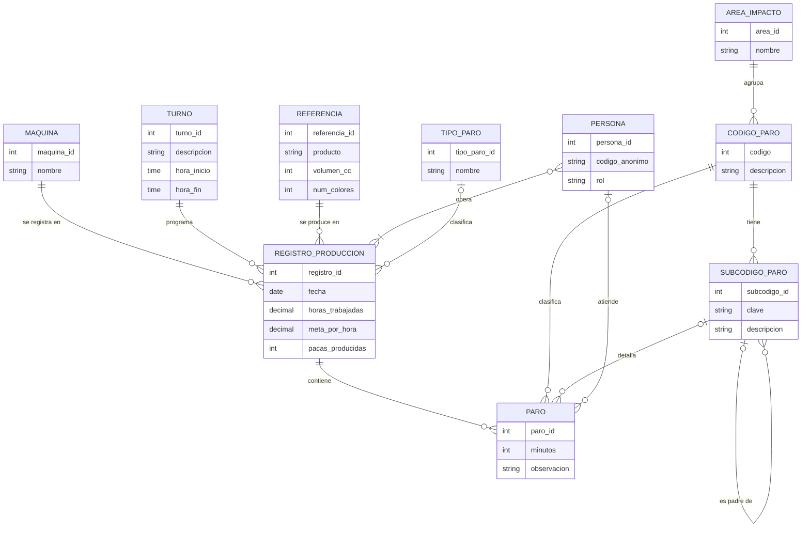

# Modelo conceptual (MER) – Pascualitos

Notación: pata de gallo (Crow's Foot). Este modelo presenta entidades, atributos y relaciones; no incluye llaves foráneas como columnas.

## Diagrama

## Cardinalidades y participación

| Relación | Cardinalidad | Participación |
|---|---|---|
| MAQUINA – REGISTRO_PRODUCCION | 1:N | Máquina parcial; registro total |
| TURNO – REGISTRO_PRODUCCION | 1:N | Turno parcial; registro total |
| REFERENCIA – REGISTRO_PRODUCCION | 1:N | Referencia parcial; registro total |
| PERSONA – REGISTRO_PRODUCCION | N:M | Persona parcial; registro total |
| REGISTRO_PRODUCCION – PARO | 1:N | Registro parcial; paro total |
| CODIGO_PARO – PARO | 1:N | Código parcial; paro total |
| SUBCODIGO_PARO – PARO | 1:N | Subcódigo parcial; paro parcial |
| PERSONA – PARO | 1:N | Persona parcial; paro parcial |
| AREA_IMPACTO – CODIGO_PARO | 1:N | Área parcial; código total |
| CODIGO_PARO – SUBCODIGO_PARO | 1:N | Código parcial; subcódigo total |
| TIPO_PARO – REGISTRO_PRODUCCION | 1:N | Tipo parcial; registro parcial |
| SUBCODIGO_PARO – SUBCODIGO_PARO | 1:N | Participación parcial en ambos lados |

**Nota:** el MER representa la relación PERSONA–REGISTRO_PRODUCCION como N:M. Al derivar el modelo lógico, esta relación requiere una tabla intermedia (por ejemplo, `registro_persona`) si un registro puede tener varias personas y una persona puede participar en varios registros.
